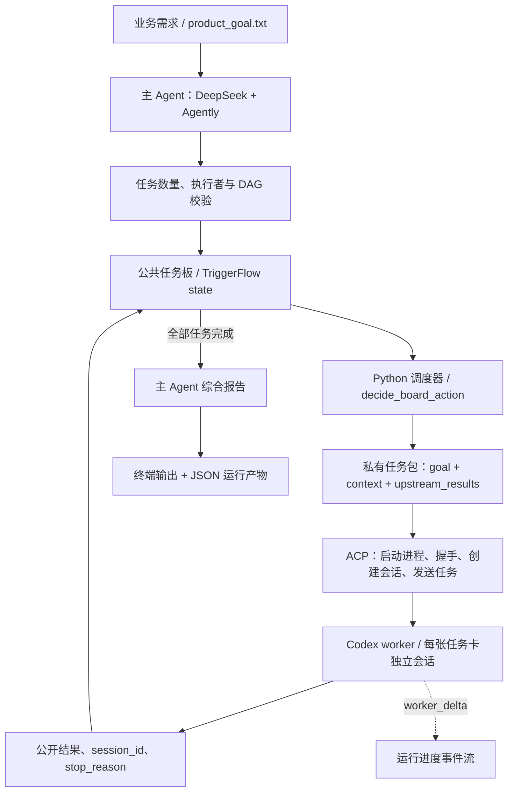
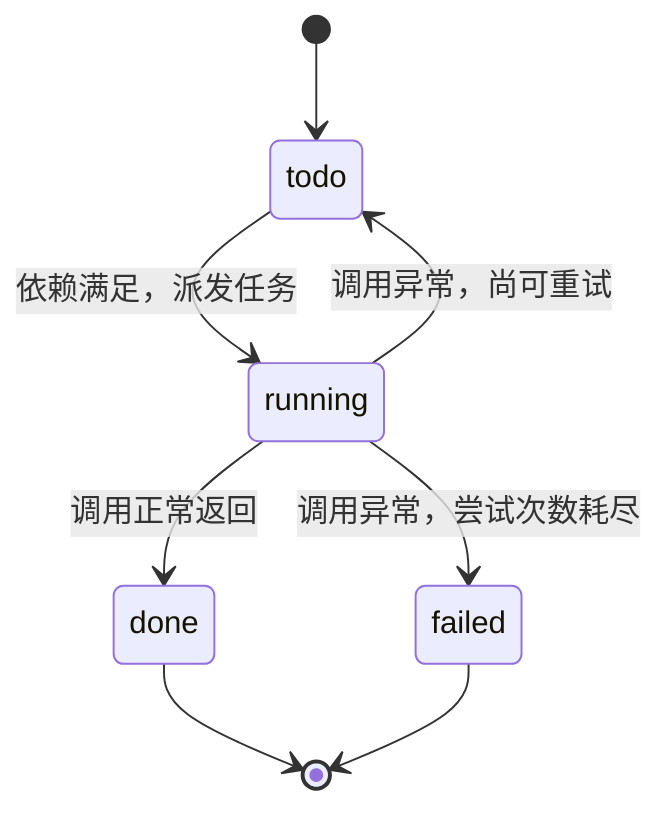

# AgentFlow

**让主 Agent 拆任务，让子 Agent 分工执行，让任务板记录整个协作过程。**

AgentFlow 是一个 Python 多 Agent 任务编排示例，使用 **DeepSeek + Agently** 生成任务计划，通过 **ACP** 调用本地 **Codex** 子 Agent，并由 **TriggerFlow** 承载任务状态与进度事件。

项目以“杭州三天两晚团建规划”为示例：输入业务需求，自动拆解带依赖关系的子任务，逐个回收结果，最终生成行程草案、信息缺口、风险提示和待确认问题。修改 `materials/product_goal.txt`，可以尝试其他以文字分析和方案规划为主的任务。

## 功能

| 功能 | 具体实现 |
| --- | --- |
| 动态任务规划 | 主 Agent 根据需求生成 2～6 张任务卡，自行决定任务内容、执行者和依赖关系 |
| DAG 结构校验 | 检查任务数量、ID 格式、重复 ID、执行者白名单、依赖存在性、自依赖和循环依赖 |
| 按依赖调度 | 只有所有上游任务都完成的任务才会进入执行阶段；当前逐张串行执行 |
| 上下文裁剪 | 子 Agent 接收自己的目标、背景和显式依赖的上游结果，不传入完整主会话 |
| ACP 会话调用 | 启动 Codex ACP 适配器，完成握手、创建会话、发送任务和接收文本更新 |
| 异常重试 | 子任务调用抛出异常时最多尝试两次；达到上限后标记失败并阻塞流程 |
| 流式进度 | 输出任务创建、开始、文字增量、完成、重试和失败等事件 |
| 最终综合 | 主 Agent 结合原始目标和任务板结果，生成结构化报告并保存 JSON |

## 架构



各层职责：

| 层 | 责任 |
| --- | --- |
| DeepSeek + Agently | 理解业务目标、生成结构化任务板、综合最终报告 |
| Python 调度逻辑 | 校验计划、判断依赖、推进状态、决定重试或结束 |
| TriggerFlow | 串联 `plan_board → dispatch_tasks → synthesize_report`，保存跨阶段状态和暴露运行事件 |
| ACP | 连接本地 Agent 进程，管理会话请求和流式更新 |
| Codex worker | 根据当前任务包完成一个局部任务，返回公开文字结果 |

规划阶段由模型决定怎么拆任务；执行顺序由确定性的 Python 规则决定。`codex_research` 和 `codex_plan` 使用相同的 Codex 适配器启动配置，是两个逻辑执行者名称；实际分工来自各自收到的任务包。

## 实现方式

### 1. 用数据契约组织协作

| 数据结构 | 内容 |
| --- | --- |
| `ProjectBrief` | 原始业务目标及其来源 |
| `TaskCard` | 任务 ID、标题、执行者、目标、背景、依赖、状态、结果、会话 ID 和尝试次数 |
| `WorkerTaskInput` | 单个子 Agent 可见的任务信息、上游结果、验收要求和执行约束 |
| `WorkerResult` | Agent 名称、会话 ID、停止原因、文本结果、更新类型和权限决定 |
| `BoardDecision` | 当前应执行 `dispatch`、`retry`、`blocked` 还是 `finish` |

### 2. 用任务板推进状态

`create_board_request()` 请求模型生成任务板，`validate_model_board()` 校验结果，`ensure_board_is_dag()` 检查依赖是否成环。任务板生成失败时会暴露错误，不会替换成预设任务。

调度循环由 `dispatch_tasks()` 实现：

1. 读取任务板，检查是否存在失败任务。
2. 找到第一张状态为 `todo` 且所有依赖都为 `done` 的任务卡。
3. 标记为 `running`，增加尝试次数并写回状态。
4. 构建任务包，通过 ACP 调用子 Agent。
5. 回收结果，或在调用异常时重试。
6. 全部任务完成后进入报告综合阶段。



这里的 `done` 表示当前代码已回收 worker 返回值。输出内容是否充分满足业务要求，仍是待补充的验收能力，详见“当前边界”。

### 3. 给每个子任务裁剪上下文

`build_worker_input()` 只提取 `depends_on` 指定的上游结果，并对过长文本截断。其他已完成但无依赖关系的任务不会自动进入当前子 Agent 的输入。

正式调度中，每张任务卡都会创建一个新的 ACP 会话。`02_worker_acp_smoke.py` 另外演示了同一会话内的两轮调用；正式业务流程目前没有接入同会话追问。

### 4. 将调用过程转成可观察事件

ACP 调用生命周期是：

```text
启动 Codex ACP 进程
  → initialize
  → new_session
  → prompt
  → session_update / agent_message_chunk
  → 回收结果并退出进程上下文
```

`CourseAcpClient` 收集公开文本，将文本增量转成 `worker_delta` 事件。运行中还会产生 `board_created`、`task_started`、`task_done`、`task_retry`、`task_failed`、`dispatch_done` 和 `final_report_ready` 等事件。

## 代码结构

```text
AgentFlow/
├── scripts/
│   ├── 01_plan_board.py                 # 主 Agent 动态生成并校验任务板
│   ├── 02_worker_acp_smoke.py           # 验证 ACP 连接和同会话多轮调用
│   ├── 03_context_isolation.py         # 演示上游结果如何进入私有任务包
│   ├── 04_triggerflow_master_loop.py   # 完整主 Agent 调度流程，主要入口
│   └── 05_hangzhou_team_building_run.py # 读取完整运行产物并检查、展示报告
├── materials/
│   └── product_goal.txt               # 程序实际读取的示例业务输入
├── .env.example
├── .gitignore
├── .gitattributes
├── requirements.txt
└── README.md
```

脚本保留独立阅读和运行的结构，因此部分数据类、配置和 ACP 客户端代码有重复。

## 运行

### 环境准备

- Python 3.10～3.14，建议使用独立虚拟环境。
- Node.js LTS，以及可用的 npm / npx。
- 已安装并完成认证的 Codex CLI，具有可用的模型访问权限。
- 可用的 DeepSeek API Key；主 Agent 与 Codex worker 使用各自的认证和模型额度。

```bash
git clone https://github.com/wywzixin/AgentFlow.git
cd AgentFlow
python -m venv .venv
```

Windows PowerShell：

```powershell
.\.venv\Scripts\Activate.ps1
python -m pip install -r requirements.txt
Copy-Item .env.example .env

# 当前脚本在模块导入时读取启动器配置，请在启动 Python 前设置。
# 使用完整的 npx.cmd 路径，避免 Windows 子进程无法直接找到 npx。
$env:ACP_NPX_COMMAND = (Get-Command npx.cmd).Source
```

macOS / Linux：

```bash
source .venv/bin/activate
python -m pip install -r requirements.txt
cp .env.example .env
export ACP_NPX_COMMAND="$(command -v npx)"
```

在 `.env` 中填写主 Agent 配置：

```dotenv
DEEPSEEK_BASE_URL=https://api.deepseek.com/v1
DEEPSEEK_DEFAULT_MODEL=deepseek-chat
DEEPSEEK_API_KEY=your_deepseek_api_key
```

从仓库根目录运行脚本。当前 `ACP_NPX_COMMAND` 应通过终端环境变量设置；仅修改 `.env` 中的同名配置不足以更新脚本已经捕获的启动器设置。

如尚未安装 Codex CLI，可按其官方文档完成安装和认证，例如：

```bash
npm install -g @openai/codex
codex login
```

脚本使用的 ACP 适配器版本为 `@agentclientprotocol/codex-acp@1.1.0`，由 `npx` 启动；首次调用可能需要下载该包。

### 运行完整流程

```bash
python scripts/04_triggerflow_master_loop.py
python scripts/05_hangzhou_team_building_run.py
```

`04` 自行生成任务板并完成执行，不需要提前运行 `01` 或 `03`。`05` 只读取 `04` 保存的结果，不会重新调用模型。

### 分步了解各个机制

```bash
# 验证 Codex ACP 连接；这一步不调用 DeepSeek。
python scripts/02_worker_acp_smoke.py

# 生成任务板，再观察上游结果如何传递给下游。
python scripts/01_plan_board.py
python scripts/03_context_isolation.py
```

`03` 依赖 `01` 生成的任务板，会执行必要的上游任务并展示下游任务包，不负责完成整张任务板。

## 输出

完整流程生成的报告包含：

| 字段 | 内容 |
| --- | --- |
| `executive_summary` | 综合摘要 |
| `confirmed_facts` | 已确认事实 |
| `information_gaps` | 仍需补齐的信息 |
| `draft_plan` | 方案草案 |
| `risks` | 风险提示 |
| `next_questions` | 下一步确认问题 |

运行产物保存在本地 `.demo_runs/multi_agent/`：

```text
01_task_board.json
02_worker_smoke.json
03_context_isolation.json
04_triggerflow_result.json
05_hangzhou_team_building_result.json
```

各文件由对应脚本生成。完整流程的两个 JSON 文件包含业务目标、任务板、最终报告和事件流；它们是运行结束后的结果快照。`.env` 和运行产物均被 Git 忽略。

## 验证范围

发布整理时，在隔离的依赖环境中使用 `requirements.txt` 指定版本验证了全部 5 个脚本的语法与模块导入，以及任务依赖选择、上下文筛选和非法 DAG 拒绝逻辑。验证环境为 Python 3.14。

这些检查不调用外部模型。DeepSeek 请求、Codex 认证与 ACP 完整业务链路需要配置自己的服务凭据后运行验证。

## 当前边界

- 当前按依赖串行执行任务，尚未实现并发 worker 调度、运行中的动态重规划或断点续跑。
- 子 Agent 以文本分析和方案输出为主；提示词要求将实时票价、天气、供应商等外部事实列为待核验项。
- 任务包裁剪和独立会话提供上下文边界；worker 仍共享宿主工作目录和继承的环境，这不等同于操作系统级沙箱。
- 异常重试只覆盖抛出的调用异常；当前尚未对空结果、取消、截断或内容质量进行完成验收。
- ACP 握手或建会话阶段失败后的资源清理、任务级超时与取消处理仍需完善。
- 任务板在运行中存于 TriggerFlow state；完整脚本仅在成功结束后保存 JSON，未持久化完整的 `worker_inputs` / `worker_results` 记录。

## 相关项目

本示例采用主从 Agent、任务板和私有任务包的协作思路，相关设计可参考：

- [Hermes Subagent Delegation](https://hermes-agent.nousresearch.com/docs/user-guide/features/delegation)
- [Hermes Kanban](https://hermes-agent.nousresearch.com/docs/user-guide/features/kanban)
- [Agently](https://github.com/Agently/Agently)
- [Agent Client Protocol](https://agentclientprotocol.com/)
- [Codex ACP adapter](https://github.com/agentclientprotocol/codex-acp)
- [OpenAI Codex](https://github.com/openai/codex)

仓库保留 Python 源码、运行所需输入与配置示例，以及本项目说明；原有课程讲义、PDF、Notebook 和配图未包含在提交中。
